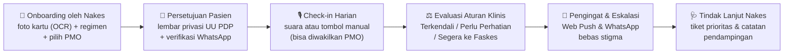
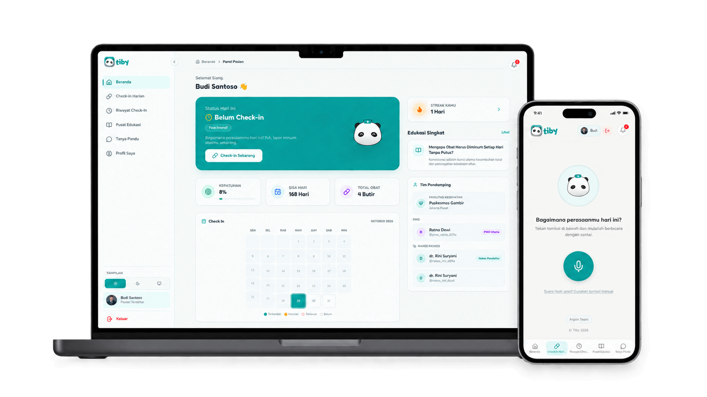
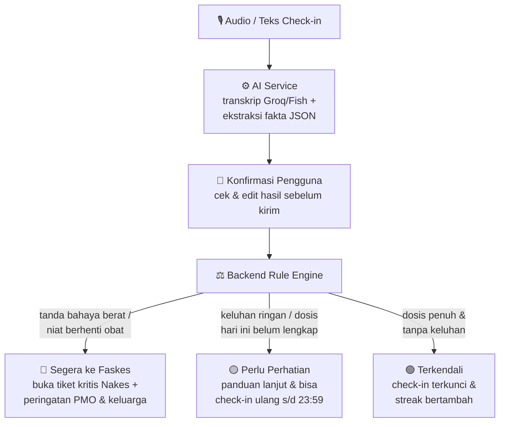
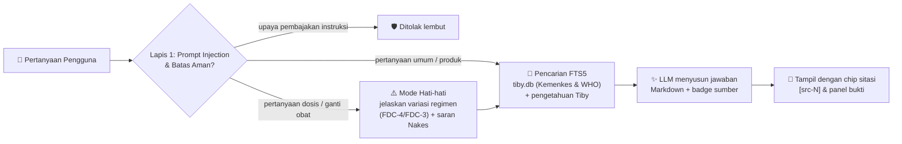
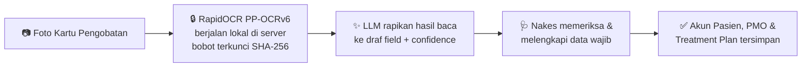
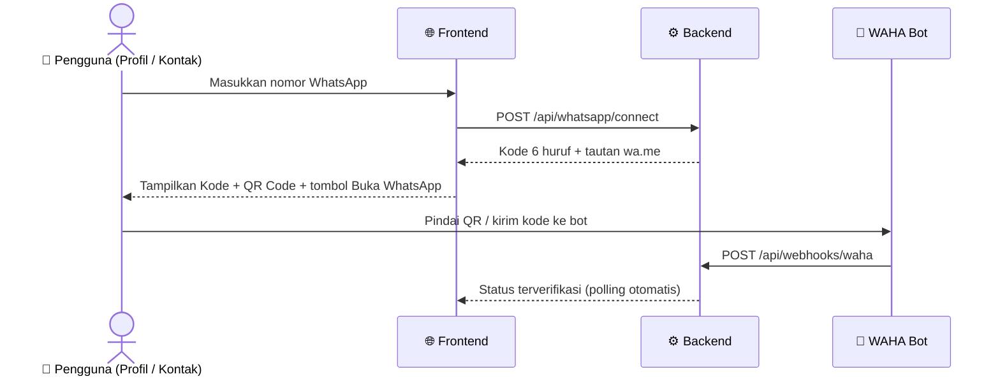
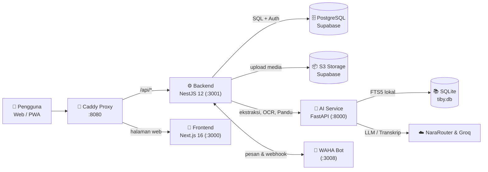
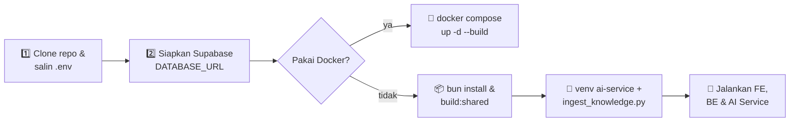
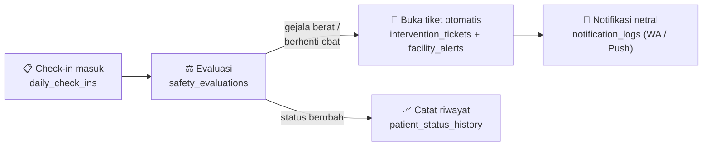

<div align="center">


# Tiby

**Pendamping Cerdas Pengobatan TBC.**

Catat minum obat harian lewat suara atau tombol cepat, pantau kepatuhan tanpa stigma bersama PMO dan tenaga kesehatan, pindai kartu pengobatan saat pendaftaran pasien, dan ajukan pertanyaan berbasis pedoman resmi Kemenkes dan WHO bersama **Pandu**.

[](https://tiby.web.id/demo)


-1f2937?style=flat-square&logo=supabase&logoColor=3ecf8e>)


Dibuat oleh **Tim Argon** untuk Web Development Competition **UINIC 8.0** (2026).

</div>

---

## 📚 Daftar isi

1. [Kenalan dulu](#-kenalan-dulu)
2. [Perjalanan pengguna di Tiby](#-perjalanan-pengguna-di-tiby)
3. [Fitur](#-fitur)
4. [Bagaimana setiap fitur bekerja](#-bagaimana-setiap-fitur-bekerja)
5. [Arsitektur](#-arsitektur)
6. [Setup di laptop sendiri](#-setup-di-laptop-sendiri)
7. [Kalau ada yang error](#-kalau-ada-yang-error)
8. [Tes dan pengecekan otomatis](#-tes-dan-pengecekan-otomatis)
9. [Isi repositori](#-isi-repositori)
10. [Database](#-database)
11. [Daftar API](#-daftar-api)
12. [Keamanan dan privasi](#-keamanan-dan-privasi)
13. [Deployment](#-deployment)
14. [Cara pakai aplikasinya](#-cara-pakai-aplikasinya)
15. [Tim Argon](#-tim-argon)
16. [Kredit](#-kredit)

---

## 👋 Kenalan dulu

Pengobatan tuberkulosis (TBC) berlangsung berbulan-bulan setiap hari. Pasien sering terlambat melapor karena lupa, kelelahan, efek samping ringan yang bikin cemas, atau khawatir diketahui orang sekitar saat notifikasi muncul di layar ponsel. Di sisi lain, Tenaga Kesehatan (Nakes) di Fasilitas Kesehatan (Faskes) harus memantau banyak pasien sekaligus dengan catatan kertas yang tersebar.

Tiby dirancang untuk menjembatani keseharian pasien, Pengawas Menelan Obat (PMO), dan Nakes dalam satu alur kerja yang tenang, netral, dan terukur. Semua keputusan keselamatan klinis tetap ditentukan aturan baku di server—AI hanya membantu merapikan laporan suara, membaca kartu pengobatan, dan menjawab edukasi dari sumber resmi.

|                  |                                                           |
| ---------------- | --------------------------------------------------------- |
| 🎯 **Subtema**   | Kesehatan                                                 |
| 🌍 **SDGs**      | Nomor 3 (Kehidupan Sehat dan Sejahtera)                   |
| 👥 **Pengguna**  | Pasien, PMO (Keluarga / Kader), Nakes (Faskes), dan Admin |
| 🏆 **Kompetisi** | Web Development Competition UINIC 8.0 (2026)              |

---

## 🧭 Perjalanan pengguna di Tiby

Akun Tiby dibuat oleh Tenaga Kesehatan di Faskes (bukan pendaftaran mandiri bebas) agar jadwal pengobatan, regimen obat, dan kontak pendamping tercatat sejak hari pertama.



Ringkasan tanggung jawab setiap peran di dalam Tiby:

| Peran                 | Fokus utama                    | Apa yang bisa dilakukan                                                                                                                                           |
| --------------------- | ------------------------------ | ----------------------------------------------------------------------------------------------------------------------------------------------------------------- |
| 🧑‍⚕️ **Nakes (Faskes)** | Pemantauan risiko & intervensi | Mendaftarkan pasien baru (+ OCR kartu), memantau daftar pasien terurut risiko, menangani tiket merah/putus kontak, mengelola edukasi faskes                       |
| 👤 **Pasien**         | Kepatuhan minum obat harian    | Melapor lewat suara/tombol manual, melihat kalender riwayat & _streak_, membaca Pusat Edukasi, bertanya ke Pandu, mengelola kontak darurat & WhatsApp             |
| 🤝 **PMO**            | Pendampingan dekat             | Melihat status harian & _streak_ pasien binaan, membantu check-in bila pasien berhalangan, mencatat tindak lanjut (tanpa bisa membaca keluhan/transkrip sensitif) |
| 🛡️ **Admin**          | Operasional platform           | Mengelola Faskes, membuat/mengatur akun pengguna & reset kata sandi, mengelola materi edukasi global, simulasi notifikasi                                         |

---

## ✨ Fitur

### 👤 Untuk Pasien

|     | Modul                                 | Buat apa                                                                                                                                                   |
| --- | ------------------------------------- | ---------------------------------------------------------------------------------------------------------------------------------------------------------- |
| 🎙️  | **Check-in Suara & Manual**           | Rekam laporan suara harian lalu tinjau hasil transkrip sebelum dikirim, atau gunakan tombol status manual (_Sudah Minum_ / _Belum Minum_ / _Tidak Pasti_). |
| 🔥  | **Streak & Kalender Riwayat**         | Pantau sisa hari pengobatan, tingkat kepatuhan, _streak_ harian, dan catatan check-in setiap tanggal.                                                      |
| 🤖  | **Tanya Pandu**                       | Tanya jawab edukasi seputar pengobatan dan cara pakai Tiby yang dijawab dengan sitasi resmi Kemenkes/WHO serta pengetahuan produk Tiby.                    |
| 📖  | **Pusat Edukasi**                     | Kartu edukasi fase Intensif dan Lanjutan dari Faskes serta panduan resmi yang tersusun rapi dalam format Markdown.                                         |
| 💬  | **Pengingat Netral & Kontak Darurat** | Hubungkan WhatsApp lewat kode 6 karakter / QR Code serta aktifkan Web Push. Daftarkan anggota keluarga sebagai kontak darurat bila berhalangan melapor.    |

### 🤝 Untuk PMO & 🩺 Nakes / Faskes

|     | Modul                                 | Buat apa                                                                                                                                                                |
| --- | ------------------------------------- | ----------------------------------------------------------------------------------------------------------------------------------------------------------------------- |
| 📷  | **Onboarding + OCR Kartu Pengobatan** | Foto kartu pengobatan pasien saat pendaftaran; AI mengekstrak draf nama, regimen (`FDC-4`, `FDC-3`, `HRZE`, dll.), fase, dan jumlah tablet untuk diperiksa ulang Nakes. |
| 🚨  | **Tiket Tindak Lanjut & Peringatan**  | Gejala berat atau tidak melapor berhari-hari (H+3) otomatis membuka tiket kritis di Faskes agar Nakes bisa segera menindaklanjuti.                                      |
| 📊  | **Daftar Pasien Terurut Risiko**      | Pasien dengan status kritis atau berisiko muncul di urutan teratas lengkap dengan riwayat status dan tiket.                                                             |
| 🛡️  | **Panel Admin & Mode Demo (`/demo`)** | Pengelolaan Faskes, akun, template edukasi, serta sesi **Mode Demo 2 jam** untuk mencoba alur Pasien, PMO, dan Nakes tanpa login akun produksi.                         |

<div align="center">

<br/><sub>Tiby berjalan responsif di peramban desktop maupun ponsel sebagai PWA</sub>
</div>

---

## 🔬 Bagaimana setiap fitur bekerja

### 🎙️ Check-in Suara & Evaluasi Keselamatan Klinis

AI bertugas membantu menyalin suara ke teks dan mengekstrak fakta yang diucapkan pasien (_apa yang diminum_, _keluhan yang disebut_). Keputusan status tetap dijalankan **rule engine deterministik** di backend—tidak pernah diserahkan ke LLM.



### 🤖 Tanya Pandu: Guardrails 2 Lapis & Sitasi Resmi



### 📷 Onboarding OCR Kartu Pengobatan



### 💬 Verifikasi WhatsApp (QR Code + WAHA) & Eskalasi Bebas Stigma



Bila pasien melewatkan check-in harian, sistem menjalankan eskalasi bertahap secara netral tanpa menyebut diagnosis penyakit:
`H+1` pengingat pasien → `H+2` status _Berisiko_ + peringatan ke PMO & kontak keluarga → `H+3` tiket tindak lanjut kritis di Faskes (tertutup otomatis bila pasien kembali melapor dosis penuh) → `H+7` status _Putus Follow-up_.

---

## 🧩 Arsitektur

Tiby berbentuk **Bun monorepo** dengan tiga layanan independen (`frontend`, `backend`, `ai-service`) dan paket kontrak bersama di `shared/`:



Aturan batas tanggung jawab antar service:

- **Frontend (`app/frontend`)** hanya berkomunikasi dengan **Backend**. Tidak pernah mengakses database atau AI Service secara langsung.
- **Backend (`app/backend`)** memegang kepemilikan penuh atas autentikasi (Better Auth), enkripsi PII, database PostgreSQL, jadwal pengingat/eskalasi, WhatsApp/Web Push, dan rule engine klinis.
- **AI Service (`app/ai-service`)** bersifat _stateless_ untuk tugas NLP/OCR (`POST /ai/extractions/*`, `POST /ai/guidance`, `POST /ai/ocr/extract`) dengan indeks lokal `tiby.db`.
- **`shared/`** hanya berisi skema validasi + tipe TypeScript (`shared/ts-shared`) dan kontrak HTTP OpenCollection/Bruno (`shared/api-contract`), bukan logika bisnis.

| Komponen               | Teknologi                                                   | Port   | Peran                                                                |
| ---------------------- | ----------------------------------------------------------- | ------ | -------------------------------------------------------------------- |
| Frontend               | Next.js 16 (App Router), React 19, Tailwind CSS 4           | `3000` | Antarmuka Pasien, PMO, Nakes, Admin, Publik, Demo, Contact           |
| Backend                | NestJS 12, TypeORM, Better Auth, Zod                        | `3001` | REST API `/api/*`, keamanan, rule engine, penjadwalan, WAHA          |
| AI Service             | FastAPI, Python 3.10 (`uv`), RapidOCR, PyMuPDF, SQLite FTS5 | `8000` | Transkripsi audio, ekstraksi check-in, Tanya Pandu RAG, OCR kartu    |
| Database & Storage     | PostgreSQL + S3-compatible (Supabase)                       | —      | Penyimpanan data terenkripsi PII dan berkas unggahan                 |
| WhatsApp Gateway       | WAHA (`devlikeapro/waha`)                                   | `3008` | Pengiriman pengingat dan penerimaan webhook verifikasi               |
| Reverse Proxy & Tunnel | Caddy + `cloudflared` (opsional)                            | `8080` | Entrypoint tunggal produksi (`/api/*` → Backend, lainnya → Frontend) |

---

## 🚀 Setup di laptop sendiri

Ada dua jalur: **Cara A (Docker Compose)** untuk menjalankan seluruh stack sekaligus, atau **Cara B (Tanpa Docker)** untuk pengembangan tiap service secara terpisah.



### 🧰 Prasyarat

| Alat                                                              | Kebutuhan                               | Cek terpasang                       |
| ----------------------------------------------------------------- | --------------------------------------- | ----------------------------------- |
| [Git](https://git-scm.com)                                        | Bebas                                   | `git --version`                     |
| [Bun](https://bun.sh)                                             | v1.4+ (untuk Cara B & scripts monorepo) | `bun --version`                     |
| [Python + uv](https://docs.astral.sh/uv/)                         | Python 3.10 + `uv` (Cara B AI Service)  | `python3 --version && uv --version` |
| [Docker Engine + Compose v2](https://docs.docker.com/get-docker/) | Untuk Cara A                            | `docker compose version`            |

Selain itu siapkan:

- **PostgreSQL (Supabase)** untuk `DATABASE_URL` (dan S3 Storage bila menguji unggah berkas).
- **Kunci provider AI** (**NaraRouter** dan **Groq**) jika ingin menguji AI secara nyata; tanpa kunci asli, AI service tetap menyala (untuk uji offline atau health check) dan mengembalikan `503` saat rute AI dipanggil.

---

### 1️⃣ Ambil kode & siapkan `.env` root

```bash
git clone https://github.com/mcqeems/tiby.git
cd tiby
cp .env.example .env
```

Isi `DATABASE_URL` di `.env` root memakai string koneksi **Connection Pooling (Supavisor)** dari **Supabase → Project Settings → Database** berakhiran `?sslmode=no-verify`:

```env
DATABASE_URL=postgresql://postgres.<project-ref>:<db-password>@aws-0-<region>.pooler.supabase.com:5432/postgres?sslmode=no-verify
```

> 💡 **Kenapa `?sslmode=no-verify`?** Koneksi tetap terenkripsi TLS, tetapi driver Node `pg` menolak rantai sertifikat CA internal pooler Supabase bila memakai `sslmode=require`. Mode session port `5432` kompatibel penuh dengan TypeORM dan Better Auth, dan aman di server tanpa egress IPv6.

---

### 2️⃣ Cara A — Jalankan seluruh stack dengan Docker Compose

File `docker-compose.yml` di root sudah membawa nilai **dummy** bawaan untuk uji lokal agar cepat menyala. Untuk pemakaian nyata/publik, ganti seluruh kredensial dummy sebelum deploy.

```bash
docker compose up -d --build
```

Verifikasi seluruh container aktif:

```bash
docker compose ps                   # cek status healthy
curl http://localhost:3000          # halaman frontend
curl http://localhost:3001/api      # {"status":"ok"}
curl http://localhost:8000/health   # {"status":"ok"}
```

Catatan _first boot_ Docker:

- `auth-migrate` otomatis membuat tabel Better Auth (`users`, `session`, `account`, `verification`) sebelum `backend` start. Cek log dengan `docker compose logs auth-migrate`.
- `seed-admin` membuat satu akun `ADMIN` awal secara aman (_upsert_), melewati dirinya sendiri bila `SEED_ADMIN_PASSWORD` masih placeholder (`CHANGE_ME_MIN_12_CHARS`).
- **Pairing WhatsApp**: buka dashboard WAHA di `http://localhost:3008` (login default lokal `admin` / `dummy-admin-password`), lalu pindai QR pada sesi `default`.
- **Data demo (opsional)**: `docker compose exec backend bun run seed`.

---

### 3️⃣ Cara B — Jalankan langsung tanpa Docker (Mode Development)

```bash
# 1. Pasang dependensi workspace dan build kontrak bersama (wajib pertama!)
bun install
bun run build:shared

# 2. Siapkan .env tiap service
cp app/backend/.env.example app/backend/.env
cp app/frontend/.env.example app/frontend/.env
cp app/ai-service/.env.example app/ai-service/.env
```

```bash
# 3. Siapkan AI Service (terminal 1)
cd app/ai-service
uv sync --group dev
uv run python scripts/ingest_knowledge.py   # bangun indeks FTS5 lokal dataset/knowledge/tiby.db
uv run uvicorn main:app --reload            # http://localhost:8000 (docs: /docs)
```

```bash
# 4. Seed akun dev & jalankan Backend + Frontend (dari root, terminal 2)
bun run seed       # buat akun contoh admin, nakes, pasien, pmo
bun run dev        # backend (:3001) + frontend (:3000) bersamaan
```

Atau jalankan terpisah: `bun run dev:backend` dan `bun run dev:frontend`.

---

### 4️⃣ Tabel Variabel Environment Penting

Aturan wajib:

1. Jangan pernah men-commit `.env`, token, atau kunci asli ke Git.
2. `NEXT_PUBLIC_API_URL` di-bake ke bundle frontend saat build—setiap perubahan wajib rebuild frontend.
3. Nilai WAHA pada service `backend` dan `waha` harus identik (`WAHA_API_KEY` dan `WAHA_WEBHOOK_SECRET` = nilai `X-Waha-Secret` di `WHATSAPP_HOOK_CUSTOM_HEADERS`).

**Backend (`app/backend/.env` / `docker-compose.yml`):**

| Variabel                                                                            | Wajib          | Keterangan                                                                                         |
| ----------------------------------------------------------------------------------- | -------------- | -------------------------------------------------------------------------------------------------- |
| `DATABASE_URL`                                                                      | Ya             | Connection string Postgres Supabase berakhiran `?sslmode=no-verify`                                |
| `BETTER_AUTH_SECRET`                                                                | Ya             | String acak minimal 32 karakter                                                                    |
| `BETTER_AUTH_URL`                                                                   | Ya             | Origin publik backend, mis. `https://tiby.web.id` atau `http://localhost:3001`                     |
| `WEB_URL`                                                                           | Ya             | Origin frontend yang diizinkan CORS (dipisah koma bila lebih dari satu)                            |
| `PII_ENCRYPTION_KEY`                                                                | Ya             | Kunci hex 64 karakter (32 byte) untuk enkripsi data identitas pasien                               |
| `VAPID_PUBLIC_KEY`, `VAPID_PRIVATE_KEY`                                             | Ya             | Pasangan kunci Web Push (generate baru sebelum produksi)                                           |
| `AI_SERVICE_URL`                                                                    | Ya             | URL AI service (`http://ai-service:8000` di Docker, `http://localhost:8000` lokal)                 |
| `S3_ENDPOINT`, `S3_ACCESS_KEY_ID`, `S3_SECRET_ACCESS_KEY`, `S3_BUCKET`, `S3_REGION` | Untuk upload   | Kredensial object storage S3-compatible (mis. Supabase Storage)                                    |
| `S3_PUBLIC_BASE_URL`                                                                | Disarankan     | URL baca publik `/object/public/<bucket>` agar file yang diunggah bisa dibuka (`200`, bukan `403`) |
| `WAHA_BOT_PHONE_NUMBER`, `WAHA_API_KEY`, `WAHA_WEBHOOK_SECRET`                      | Untuk WhatsApp | Nomor bot internasional tanpa `+` serta kunci API & webhook yang cocok                             |

**AI Service (`app/ai-service/.env`):**

| Variabel                                                             | Wajib       | Keterangan                                                                                                             |
| -------------------------------------------------------------------- | ----------- | ---------------------------------------------------------------------------------------------------------------------- |
| `NARAROUTER_API_TOKEN` / `NARAROUTER_API_KEY`, `NARAROUTER_BASE_URL` | Untuk AI    | Akses LLM ekstraksi check-in, rapikan OCR, dan Tanya Pandu (`BASE_URL` berakhiran `/v1`; model lewat `TIBY_LLM_MODEL`) |
| `GROQ_API_KEY`, `GROQ_ENDPOINT`                                      | Untuk audio | Transkripsi audio default (`TIBY_TRANSCRIBER=groq`)                                                                    |
| `FISH_AUDIO_API_TOKEN`, `FISH_API_KEY`, `FISH_ENDPOINT`              | Opsional    | Alternatif transkripsi audio saat `TIBY_TRANSCRIBER=fish`                                                              |
| `TIBY_OCR_MODEL_DIR`                                                 | Opsional    | Direktori pre-staged bobot RapidOCR lokal (menggantikan cache default)                                                 |

---

## 🩹 Kalau ada yang error

| Gejala                                                                        | Penyebab                                                              | Tindakan                                                                                                                       |
| ----------------------------------------------------------------------------- | --------------------------------------------------------------------- | ------------------------------------------------------------------------------------------------------------------------------ |
| TypeScript / tes komplain schema `@tiby/ts-shared` tidak ditemukan atau usang | Paket kontrak bersama belum di-build ulang                            | Jalankan `bun run build:shared` dari root repo                                                                                 |
| Tanya Pandu selalu menjawab `answer: null` di lokal                           | Indeks `tiby.db` belum dibuat                                         | Jalankan `cd app/ai-service && uv run python scripts/ingest_knowledge.py`                                                      |
| Log backend: `Database schema mismatch`                                       | Tabel Better Auth belum dibuat                                        | Pastikan `auth-migrate` selesai (`docker compose logs auth-migrate`), lalu `docker compose restart backend`                    |
| Frontend tampil, tetapi panggilan API gagal                                   | `NEXT_PUBLIC_API_URL` salah atau berubah setelah build                | Perbaiki nilainya lalu rebuild frontend (`docker compose build frontend && docker compose up -d`)                              |
| AI service crash: `No module named 'httpx'`                                   | Dependency group `dev` terlewat saat build Docker                     | Rebuild ai-service; Dockerfile harus memakai `uv sync --frozen` **tanpa** `--no-dev` (`providers/fish.py` mengimpor `httpx`)   |
| Webhook WAHA ditolak backend                                                  | Secret webhook tidak sama                                             | Samakan `WAHA_WEBHOOK_SECRET` (backend) dengan header `X-Waha-Secret` (service `waha`), lalu recreate                          |
| WAHA API membalas `401`                                                       | Header `X-Api-Key` tidak sesuai `WAHA_API_KEY`                        | Samakan API key antara `backend` dan `waha`                                                                                    |
| File terunggah, tetapi URL-nya membalas `403` saat dibuka                     | `S3_PUBLIC_BASE_URL` kosong sehingga URL memakai endpoint S3          | Isi `S3_PUBLIC_BASE_URL` dengan URL `/storage/v1/object/public/<bucket>`, lalu recreate backend                                |
| `auth-migrate` gagal: `self-signed certificate in certificate chain`          | Driver `pg` menolak sertifikat pooler Supabase pada `sslmode=require` | Akhiri `DATABASE_URL` dengan `?sslmode=no-verify`, lalu jalankan ulang stack                                                   |
| `auth-migrate` gagal: `relation "users" already exists`                       | Database sudah berisi tabel auth dari deploy/restore sebelumnya       | Normal untuk DB non-kosong; jalankan service tanpa gerbang: `docker compose up -d --no-deps backend seed-admin frontend proxy` |
| Restore dump lokal gagal: `function public.uuid_generate_v4() does not exist` | Ekstensi `uuid-ossp` Supabase berada di schema `extensions`           | Jalankan sekali sebelum restore: `ALTER EXTENSION "uuid-ossp" SET SCHEMA public;`, lalu restore dari schema kosong             |

---

## 🧪 Tes dan pengecekan otomatis

### Frontend & Kontrak Bersama

```bash
bun run build:shared     # wajib sebelum test/build agar dist/ terbarui
bun run test:frontend    # Vitest unit & invarian (guidance, markdown, contact, ocr, invariants)
bun run lint:frontend    # ESLint
bun run build:frontend   # Verifikasi tipe + Next.js production build
```

Cakupan invarian penting di [`app/frontend/test/invariants.spec.ts`](app/frontend/test/invariants.spec.ts):

- **Zero-stigma copy**: memblokir penyebutan `TBC`, `Tuberkulosis`, `TB`, `anti-TB` pada notifikasi keluar (WhatsApp, Push, Notifikasi dalam aplikasi), Tanya Pandu, dan metadata rute terautentikasi.
- **PMO transcript blindness**: memastikan layar `/pmo` tidak membaca atau menampilkan transkrip suara maupun detail keluhan pasien.
- **Consent gate**: memastikan tata letak `/pasien` dan `/pmo` memasang `ConsentModal` sebelum akses fitur klinis.

### Backend

```bash
bun run test:backend                                     # 28 file unit test (Vitest)
bun --filter @tiby/backend test:e2e test/<nama>.e2e-spec.ts  # butuh DATABASE_URL hidup
```

### AI Service

```bash
cd app/ai-service
uv run pytest -q             # tes offline: safety, RAG, OCR lokal, kontrak API, manifest pengetahuan
uv run ruff check src tests  # linting Python (selalu jalankan dari app/ai-service)
uv run mypy src              # type-checking ketat
```

Untuk pengujian akurasi terhadap provider LLM/transkripsi nyata (menggunakan kredensial di `app/ai-service/.env`):

```bash
uv run python tests/test_live_providers.py --list
uv run python tests/test_live_providers.py --only extraction --repeat 3
uv run python tests/test_guidance_prompts.py
```

---

## 📁 Isi repositori

```text
tiby/
├── app/
│   ├── frontend/                     🎨 Next.js 16 (App Router)
│   │   ├── app/                      Halaman per peran (admin/, nakes/, pmo/, pasien/)
│   │   │                             & publik (/, login/, demo/, contact/, register/)
│   │   ├── components/               Komponen UI: check-in, Tanya Pandu, MarkdownContent,
│   │   │                             WhatsApp QR, maskot Pandu, landing
│   │   ├── lib/                      Klien API per domain, formatter, helper contact & safety
│   │   ├── public/                   Logo, animasi Lottie, maskot, PWA service worker
│   │   └── test/                     Unit test & penjaga invarian (Vitest)
│   ├── backend/                      ⚙️ NestJS 12 REST API
│   │   ├── src/auth/                 Better Auth + tabel auth
│   │   ├── src/database/             Daftar entitas TypeORM & seeder
│   │   ├── src/modules/              Check-ins, onboarding, patients, tickets, alerts,
│   │   │                             guidance, whatsapp, push, education, demo, stats, users
│   │   └── test/                     Unit test & E2E per domain
│   └── ai-service/                   🧠 FastAPI (Python 3.10)
│       ├── src/extraction/           Normalisasi transkrip & ekstraksi fakta check-in
│       ├── src/guidance/             Guardrails 2 lapis, SQLite FTS5 RAG, pengetahuan Tiby
│       ├── src/onboarding_ocr/       RapidOCR PP-OCRv6 lokal & pemetaan kartu pasien
│       ├── src/providers/            Adaptor NaraRouter (LLM), Groq & Fish Audio
│       ├── dataset/knowledge/        PDF resmi Kemenkes/WHO + manifest.json
│       ├── scripts/                  ingest_knowledge.py (pembangun indeks FTS5)
│       └── tests/                    Pytest offline + evaluasi live provider
├── shared/
│   ├── ts-shared/                    📦 Skema Zod & tipe TypeScript (FE + BE)
│   ├── api-contract/                 📑 Source of truth HTTP (koleksi OpenCollection/Bruno)
│   └── assets/                       Aset bersama
├── infra/
│   ├── proxy/                        Dockerfile Caddy reverse proxy
│   └── waha/                         Compose WAHA mandiri
├── docker-compose.yml                🐳 Stack lokal & produksi utama (+ tunnel Cloudflare)
├── docker-compose.coolify.yml        🔁 Stack standby failover di Coolify
├── Caddyfile                         Konfigurasi routing proxy /api/* vs web
└── package.json                      Workspace scripts Bun monorepo
```

---

## 🗄️ Database

Data utama tersimpan di **21 tabel PostgreSQL** (TypeORM + Better Auth) ditambah indeks baca **SQLite FTS5** lokal pada AI Service:

| Kelompok                               | Tabel / Entitas                                                                                                                 |
| -------------------------------------- | ------------------------------------------------------------------------------------------------------------------------------- |
| 🔐 **Autentikasi & Demo**              | `users`, `session`, `account`, `verification`, `demo_sessions`                                                                  |
| 🏥 **Faskes, Terapi & Privasi**        | `facilities`, `treatment_plans`, `pmo_assignments`, `family_contacts`, `consent_records`                                        |
| 📋 **Check-in & Klinis**               | `daily_check_ins`, `safety_evaluations`, `patient_status_history`, `intervention_tickets`                                       |
| 🔔 **Notifikasi, WhatsApp & Edukasi**  | `whatsapp_verifications`, `push_subscriptions`, `notification_logs`, `user_notifications`, `facility_alerts`, `education_cards` |
| 🧾 **Audit Sistem**                    | `audit_logs`                                                                                                                    |
| 📚 **Indeks Pengetahuan (AI Service)** | `documents`, `chunks`, `chunks_fts` (dibangun saat build Docker dari PDF resmi)                                                 |

Alur otomatisasi utama dari laporan harian ke intervensi klinis:



---

## 🔌 Daftar API

Kontrak lengkap seluruh endpoint tersimpan dalam format OpenCollection (Bruno) di [`shared/api-contract/`](shared/api-contract) (buka dengan **Bruno → Open Collection**). `tests/test_api_contract.py` menjaga rute agar tidak menyimpang dari kontrak.

### ⚙️ Backend (`/api/*`)

| Domain                     | Endpoint utama                                                                                                        | Kegunaan                                                                |
| -------------------------- | --------------------------------------------------------------------------------------------------------------------- | ----------------------------------------------------------------------- |
| **Health & Auth**          | `GET /api`, `/api/auth/*`                                                                                             | Cek kesehatan backend & autentikasi Better Auth                         |
| **Onboarding & Pasien**    | `POST /api/faskes/onboarding`, `POST /api/faskes/onboarding/ocr`, `GET /api/faskes/patients`, `GET /api/pmo/patients` | Pendaftaran pasien, OCR kartu pengobatan, pemantauan Nakes & PMO        |
| **Check-in**               | `GET /api/check-ins`, `POST /api/check-ins`, `POST /api/check-ins/audio-extract`, `POST /api/check-ins/text-extract`  | Riwayat, transkripsi audio, ekstraksi fakta, dan kirim check-in harian  |
| **Tiket & Peringatan**     | `GET/POST /api/faskes/tickets`, `PATCH /api/faskes/tickets/:id/close`, `GET/PATCH /api/faskes/alerts`                 | Tindak lanjut kasus berisiko & penutupan tiket oleh Nakes               |
| **Tanya Pandu & Edukasi**  | `POST /api/guidance`, `GET/POST/PATCH/DELETE /api/education`, `GET /api/education/daily`                              | Proxy Tanya Pandu & pengelolaan kartu edukasi                           |
| **WhatsApp & Web Push**    | `POST /api/whatsapp/connect`, `GET /api/whatsapp/status`, `POST /api/webhooks/waha`, `/api/push/*`                    | Verifikasi nomor + deep link `wa.me`, webhook WAHA, langganan Push      |
| **Profil, Consent & Demo** | `/api/users/*`, `/api/consent`, `/api/patients/:id/family-contacts`, `/api/demo/*`, `/api/facilities`, `/api/stats`   | Manajemen pengguna, persetujuan UU PDP, kontak darurat, Mode Demo 2 jam |

### 🧠 AI Service (`/ai/*`)

| Metode & jalur                        | Masukan                             | Keluaran                                                                              |
| ------------------------------------- | ----------------------------------- | ------------------------------------------------------------------------------------- |
| `GET /ai/health`                      | —                                   | `{ "status": "ok" }`                                                                  |
| `POST /ai/extractions/check-in`       | JSON teks transkrip check-in        | Fakta terstruktur (`null` bila tidak disebutkan/ragu)                                 |
| `POST /ai/extractions/check-in/audio` | Multipart `audio` (maks. 10 MB)     | Teks transkrip untuk ditinjau pengguna                                                |
| `POST /ai/guidance`                   | JSON pertanyaan + konteks opsional  | Jawaban Markdown + daftar sitasi (`citation_id`, sumber, halaman PDF, cuplikan bukti) |
| `POST /ai/ocr/extract`                | Multipart `cardImage` (maks. 10 MB) | Draf field onboarding + `fieldConfidence` dan `uncertainties`                         |

Kode status error mengikuti amplop standar `ApiError`:

| Kode                  | Arti                                                        |
| --------------------- | ----------------------------------------------------------- |
| `400` / `422`         | Masukan tidak sesuai kontrak skema                          |
| `401` / `403`         | Sesi tidak valid atau peran tidak berwenang                 |
| `429`                 | Batas laju permintaan / sesi demo tercapai                  |
| `502` / `503` / `504` | Token provider AI belum diisi, provider gagal, atau timeout |

---

## 🔒 Keamanan dan privasi

- 🔐 **Enkripsi Data Identitas (PII)**: Nama, nomor telepon, dan data sensitif pasien dienkripsi di database menggunakan `PII_ENCRYPTION_KEY`.
- 🛡️ **Notifikasi Bebas Stigma**: Seluruh pesan pengingat WhatsApp, Web Push, dan notifikasi dalam aplikasi disusun netral tanpa menyebut diagnosis agar aman jika layar ponsel terlihat orang lain—dijaga otomatis oleh `invariants.spec.ts`.
- 🙈 **PMO Transcript Blindness**: PMO dapat memantau status harian, membantu melapor, dan mencatat tindak lanjut tanpa pernah bisa mengakses transkrip suara ataupun detail keluhan sensitif pasien.
- 🗑️ **Audio Tidak Disimpan**: Rekaman suara check-in hanya diproses untuk menghasilkan transkrip teks dan langsung dibuang sesuai prinsip UU PDP; persetujuan berbagi data (`ConsentRecord`) dapat dicabut pasien kapan saja di halaman profil.
- ⚖️ **Pemisahan AI & Keputusan Klinis**: AI Service tidak pernah mendiagnosis, meresepkan, atau menentukan skor risiko—evaluasi keselamatan sepenuhnya dijalankan secara deterministik oleh backend.
- 🔒 **OCR Bobot Terkunci**: Model RapidOCR PP-OCRv6 berjalan lokal tanpa unduhan runtime bebas, dikunci dengan verifikasi SHA-256 (`models.lock.json`).
- 🔑 **Rahasia Hanya di Server**: Kunci API provider AI, secret Better Auth, dan kunci S3/WAHA tidak pernah dikirim ke peramban.

---

## 🚢 Deployment

Produksi Tiby memakai arsitektur **Primary + Standby Failover**:

- **Primary Stack (`docker-compose.yml`)**: Berjalan di mesin utama melalui Caddy (`:8080`) dan **Cloudflare Tunnel** (`--profile tunnel`).
- **Standby Stack (`docker-compose.coolify.yml`)**: Berjalan di Coolify terhubung ke **database Supabase Postgres dan S3 eksternal yang sama**, serta menjadi host permanen untuk service **WAHA**. Ketika primary tidak terjangkau, Cloudflare Worker di depan `https://tiby.web.id` mengalihkan trafik ke standby secara mulus.

Langkah singkat deploy publik dengan Cloudflare Tunnel:

```bash
# 1. Isi .env root dengan DATABASE_URL (Supabase) + TUNNEL_TOKEN (Cloudflare Zero Trust)
# 2. Arahkan route Cloudflare Tunnel ke http://proxy:8080
# 3. Set BETTER_AUTH_URL, WEB_URL, dan NEXT_PUBLIC_API_URL ke https://<domain-kamu>
docker compose up -d --build
docker compose --profile tunnel up -d
```

Aturan operasional produksi yang wajib dijaga:

- **`NODE_ENV` tetap `development`** di compose selama belum ada file migrasi TypeORM (mode `production` mematikan `synchronize`).
- **Build `tiby.db` saat image dibuat**: `app/ai-service/Dockerfile` otomatis menjalankan `scripts/ingest_knowledge.py` pada tahap build dari PDF di `dataset/knowledge/raw/`.
- **Jangan tambahkan `--no-dev`** di `app/ai-service/Dockerfile`: runtime `providers/fish.py` memakai `httpx` yang berada di group `dev` pada `pyproject.toml`.
- **Update & Maintenance**:
  ```bash
  git pull && docker compose up -d --build
  docker builder prune   # image WAHA berukuran ~4 GB
  ```
- **Dokumentasi detail tiap service**: [Frontend](app/frontend/README.md) · [Backend](app/backend/README.md) · [AI Service](app/ai-service/README.md).

---

## 🎓 Cara pakai aplikasinya

1. 🎮 **Coba cepat tanpa membuat akun**: Buka **`/demo`** (atau klik **Mode Demo** di beranda/login), mulai sesi demo 2 jam, lalu masuk sebagai **Pasien**, **PMO**, atau **Nakes** dan berpindah peran kapan saja.
2. 🩺 **Masuk sebagai Nakes**: Buka **Onboarding Pasien**, unggah foto kartu pengobatan untuk mengisi draf otomatis lewat OCR, periksa regimen (`FDC-4`, `FDC-3`, dll.), lalu simpan untuk menerbitkan kredensial Pasien & PMO.
3. 👤 **Masuk sebagai Pasien**: Setujui lembar persetujuan privasi, hubungkan **WhatsApp** di **Profil Saya** (masukkan nomor → dapatkan kode 6 karakter → pindai **QR Code** atau klik **Buka WhatsApp**), lalu lakukan **Check-in Harian** lewat suara atau tombol manual.
4. 💬 **Butuh edukasi atau informasi Tiby?**: Buka **Pusat Edukasi** atau **Tanya Pandu** untuk bertanya soal efek samping ringan, kebiasaan sehat, atau cara memakai fitur aplikasi.
5. 🏥 **Ingin mendaftarkan Faskes Anda?**: Buka **`/contact`** dari halaman login atau footer untuk menghubungi admin Tiby secara langsung.

---

## 👥 Tim Argon

<!-- TODO: ganti src foto mockup di bawah dengan foto asli anggota Tim Argon -->
<table>
  <tr>
    <td align="center" width="33%">
      
    </td>
    <td align="center" width="33%">
      
    </td>
    <td align="center" width="33%">
      
    </td>
  </tr>
  <tr>
    <td align="center"><b>Mustaqim Nawahhudi Ma'arif</b></td>
    <td align="center"><b>Brucad Al-Magribi</b></td>
    <td align="center"><b>Fatih Jawwad Al Mumtaz</b></td>
  </tr>
  <tr>
    <td align="center">Team Lead &amp; Full Stack Developer</td>
    <td align="center">Frontend Developer</td>
    <td align="center">AI Engineer</td>
  </tr>
</table>

---

## 🙏 Kredit

- **Pedoman Klinis Resmi (Sumber Korpus Tanya Pandu):**
  - Kementerian Kesehatan RI — _Petunjuk Teknis Penatalaksanaan Tuberkulosis Sensitif Obat di Indonesia_ (2025)
  - Kementerian Kesehatan RI — _Pedoman Nasional Pelayanan Kedokteran Tata Laksana Tuberkulosis_ (2020)
  - WHO — _Consolidated Guidelines on Tuberculosis: Module 4: Treatment and Care_ (2025)
  - WHO — _Operational Handbook on Tuberculosis: Module 4: Treatment and Care_ (2025)
- **Teknologi & Pustaka:** Next.js, React, Tailwind CSS, NestJS, TypeORM, Better Auth, FastAPI, RapidOCR (PP-OCRv6), PyMuPDF, SQLite FTS5, WAHA, Caddy, Cloudflare Tunnel, serta provider LLM/Transkripsi NaraRouter & Groq.

---

<div align="center">

Dibuat dengan 💚 oleh **Tim Argon** untuk pendampingan pengobatan yang lebih manusiawi dan bebas stigma.

</div>
